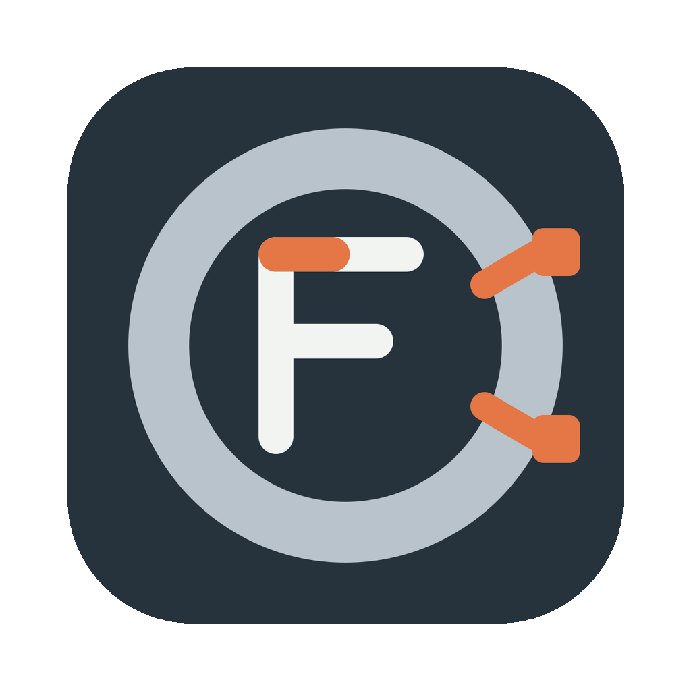

# FerriteMCU



[](https://github.com/Cattens-Roses/FerriteMCU/actions/workflows/build.yml)
[](https://github.com/Cattens-Roses/FerriteMCU/actions/workflows/cargo-deny.yml)
[](LICENSE)

FerriteMCU is a fully Rust-based native IDE intended to make Rust development for microcontrollers approachable, in the spirit of the Arduino IDE. ESP32 development is integrated in the project editor; Raspberry Pi Pico support is planned for a later release.

The current application provides a project browser, code editor, syntax highlighting, terminal, Git diff and merge tools, and local history. It uses GPUI for its native interface.

## ESP32 development

Open a Cargo project to show the ESP workflow bar. FerriteMCU includes the upstream Rust libraries
for ESP project generation (`esp-generate`), flashing (`espflash`), debugging (`probe-rs`), and
Espressif toolchain setup (`espup`); serial ports are enumerated and monitored directly in the app.
The generator uses its bundled ESP-HAL template. Build runs Cargo asynchronously and captures its
output in the IDE. Flash and Debug first build the current Cargo project. Flash programs through
the selected serial port; Debug uses a supported JTAG probe to load the ELF and start the target.
The current Debug action starts the target but does not yet provide source breakpoints or stepping.

Toolchain setup downloads and configures Espressif components using the espup library. Restart
FerriteMCU after setup so newly installed toolchain environment settings are picked up. A board
must be connected for flashing or serial monitoring, and a JTAG debug probe is required for Debug.

## Build

### Prerequisites

Install Rust 1.96 or newer with `rustup`, plus Git. The repository pins its toolchain in
`rust-toolchain.toml`. Platform build dependencies are:

- **Windows:** stable MSVC Rust toolchain, Visual Studio C++ Build Tools, and the Windows SDK.
- **macOS:** Xcode Command Line Tools and Apple's Metal Toolchain (`xcodebuild -downloadComponent MetalToolchain` if prompted).
- **Linux:** see [development notes](DEVELOPMENT.md) for the required system packages.

### Build from source

Clone the repository and build the workspace:

```sh
git clone https://github.com/Cattens-Roses/FerriteMCU.git
cd FerriteMCU
cargo build --release
```

Run the app with `cargo run --release`. To run the workspace checks locally, see
[contributing](CONTRIBUTING.md).

The binary is `ferritemcu` (`ferritemcu.exe` on Windows). Settings are stored in the `ferritemcu` application configuration directory. Existing settings from the previous application are not migrated automatically.

On first launch, FerriteMCU offers to enable the bundled JSON, Rust, Markdown, TOML, and YAML language plugins. You can skip the offer or change your selection later in Language Plugins.

## Project structure

The application lives in `src/`; reusable editor, Git, configuration, syntax, UI, and update components live in the `crates/` workspace. Future board integrations can be added as separate components without coupling hardware-specific logic to the UI.

No release feed is configured by default. `FERRITEMCU_UPDATE_FEED_URL` and `FERRITEMCU_RELEASES_FEED_URL` can point to compatible feeds when releases are available.

## Contributing and support

Bug reports, feature proposals, and pull requests are welcome. Read [contributing](CONTRIBUTING.md)
before opening a change; security issues should follow [SECURITY.md](SECURITY.md). The project
follows the [Code of Conduct](CODE_OF_CONDUCT.md).

## License and attribution

Apache-2.0; see [LICENSE](LICENSE) and [third-party notices](ThirdPartyNotices.txt). This project builds on [Kyde](https://github.com/kyle-ssg/Kyde); its original release history is preserved in [CHANGELOG.md](CHANGELOG.md).
